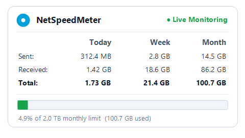
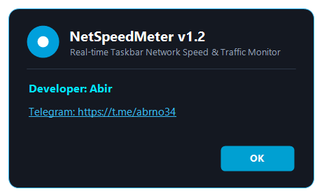
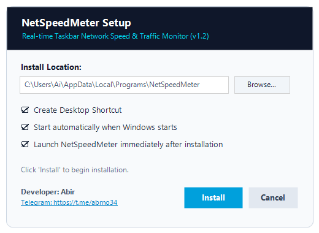

<p align="center">
  
</p>

<h1 align="center">NetSpeedMeter</h1>

<p align="center">
  <strong>Real-time Taskbar Network Speed & Bandwidth Traffic Monitor for Windows</strong>
</p>

<p align="center">
  <a href="https://github.com"></a>
  <a href="https://dotnet.microsoft.com"></a>
  <a href="https://www.microsoft.com/windows"></a>
  <a href="LICENSE"></a>
  <a href="https://t.me/abrno34"></a>
</p>

---

## 📖 Overview

**NetSpeedMeter** is a lightweight, ultra-responsive network speed and bandwidth monitoring utility engineered natively for **Windows 11, 10, 8.1, and 7**. It docks seamlessly into the Windows taskbar directly beside the system tray icons, providing live download and upload speeds at a glance without cluttering your desktop or consuming excessive system resources (<15 MB RAM, 0% CPU idle).

---

## 📸 Screenshots Showcase

<p align="center">
  
  
</p>

<p align="center">
  
  
</p>

---

## ✨ Key Features

- **📌 Native Taskbar Auto-Docking:**
  Automatically calculates the taskbar geometry and docks right next to your system tray icons without ever blocking the notification chevron (`^`). Responds automatically to display scaling and resolution changes.
  
- **🔒 Click-Lock Architecture (Never Hides):**
  Never disappears on accidental single-clicks or window focus changes. Single-clicking toggles the detailed data usage flyout, dragging repositions the meter across the taskbar, and double-clicking re-centers it.

- **📊 Today, Week & Month Traffic Tracking:**
  Accurate byte-level monitoring across three distinct timeframes:
  - **Today:** Resets every midnight.
  - **Week:** Tracks from Monday to Sunday.
  - **Month:** Tracks calendar month consumption.
  
- **🎯 2.0 TB Quota & Real-time Progress Bar:**
  Visual monthly bandwidth quota bar (default 2.0 TB / 2048 GB). Easily customizable via context menu (*Set Monthly Data Limit*). Shows exact percentage consumed and warns before hitting caps.

- **⏱ Live Bandwidth Stopwatch Tool:**
  Benchmark real-time file downloads or tests with a dedicated stopwatch tracking Elapsed Time, Total Sent, Total Received, Average Speed, and Peak Speed.

- **🚀 1-Click Standalone Installer & Uninstaller:**
  Shipped with an all-in-one setup installer (`NetSpeedMeter_Setup.exe`) that configures desktop shortcuts, Windows autostart registry, and registers a clean uninstaller in Windows Control Panel.

- **🌐 Cyber-Luxe Landing Page Included:**
  Includes a ready-to-deploy modern landing page (`index.html`) with interactive taskbar simulator, 60fps canvas waveform, and Netlify configuration (`netlify_deploy/`).

---

## 📥 Download

| File | Description | Download Link |
| :--- | :--- | :--- |
| **NetSpeedMeter_Setup.exe** | All-in-one Setup Installer (Shortcuts + Startup) | [⚡ Google Drive Download](https://drive.google.com/file/d/1j_saOqPonwnRZqkxGXkS6MLIsCPPh_vK/view?usp=sharing) |
| **NetSpeedMeter.exe** | Portable Executable (Zero install required) | Included in repository root |

---

## 🛠️ Building from Source

NetSpeedMeter requires **zero external packages or npm bloat**. It compiles natively with Microsoft C# Compiler (`csc.exe`) bundled with Windows:

```cmd
cd NetSpeedMeter
build.bat
```

The script will automatically compile:
1. `NetSpeedMeter.exe` (Main WinForms application with native API hooks)
2. `NetSpeedMeter_Setup.exe` (Standalone self-extracting installer embedding the app & icon)

---

## 🇧🇩 বাংলা বিবরণ (Bengali Overview)

**NetSpeedMeter** হলো উইন্ডোজের জন্য একটি হালকা, দ্রুত এবং প্রিমিয়াম রিয়েল-টাইম নেটওয়ার্ক স্পিড ও ডেটা মনিটরিং সফটওয়্যার।

- **টাস্কবার ইন্টিগ্রেশন:** উইন্ডোজ ১০ এবং ১১-এর টাস্কবারে নোটিফিকেশন ট্রের পাশে স্বয়ংক্রিয়ভাবে ডক হয়ে যায়।
- **ক্লিক-লক সুরক্ষা:** মিটারে ক্লিক করলে কখনো হাইড বা অফ হবে না।
- **Today, Week, Month ট্রাফিক ট্র্যাকার:** দৈনিক, সাপ্তাহিক ও মাসিক ডেটা খরচের নিখুঁত হিসাব।
- **২.০ TB ডেটা লিমিট:** মাসিক ডেটা লিমিট ও ভিজ্যুয়াল প্রগ্রেস বার।
- **ব্যান্ডউইথ স্টপওয়াচ:** নির্দিষ্ট ডাউনলোড বা স্পিড টেস্ট করার জন্য আলাদা টুল।

---

## 👨‍💻 Developer & Contact

- **Developer:** Abir
- **Telegram:** [@abrno34](https://t.me/abrno34) (`https://t.me/abrno34`)

Feel free to open an Issue or submit a Pull Request if you have suggestions or improvements!

---

## 📄 License

This project is licensed under the [MIT License](LICENSE) - see the [LICENSE](LICENSE) file for details.
